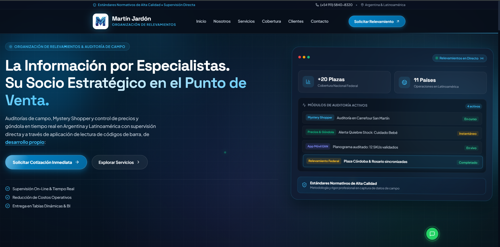
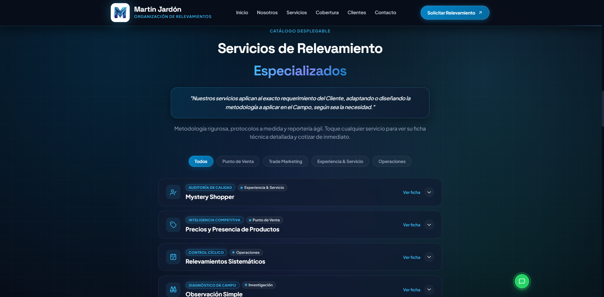
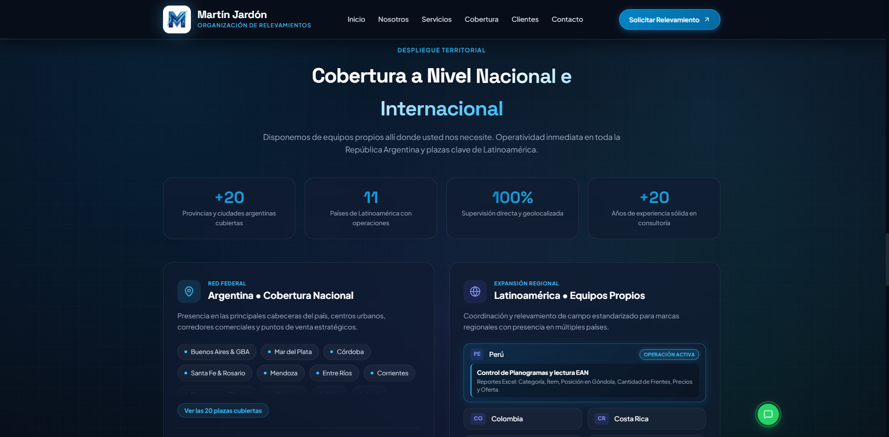
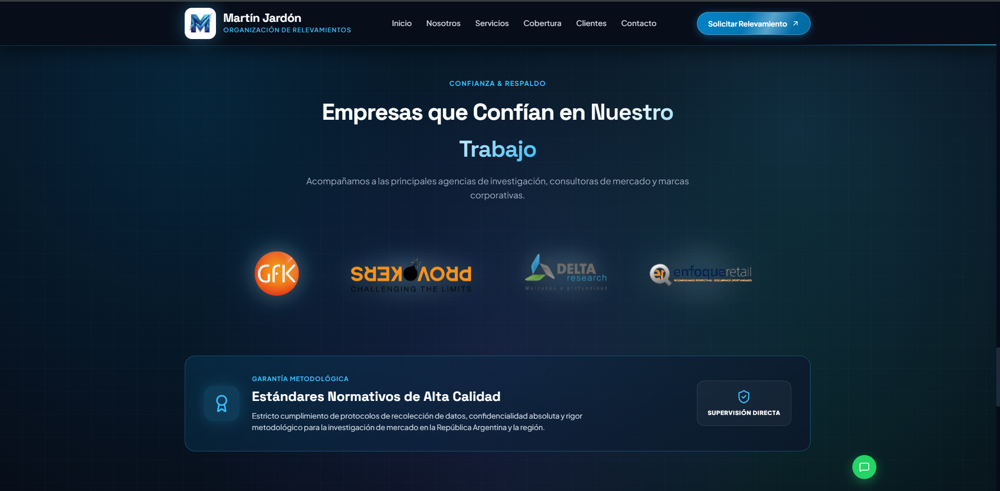

# Martín Jardón — Organización de Relevamientos

<div align="center">


<p align="center">
  <b>Plataforma web institucional y de presentación de servicios de auditoría de campo, Mystery Shopper e inteligencia comercial en Argentina y Latinoamérica.</b>
</p>

[🌐 Sitio Web Oficial](https://www.martinjardon.com.ar) • [📱 WhatsApp Directo](https://wa.me/5491158408320) • [💼 LinkedIn](https://www.linkedin.com/in/martin-jardon/)

</div>

---

## 📋 Descripción del Proyecto

Landing page corporativa de alto rendimiento desarrollada para **Martín Jardón — Organización de Relevamientos**, empresa especialista con más de 20 años de trayectoria en auditoría de puntos de venta, relevamiento de datos de mercado y consultoría estratégica en retail.

La plataforma presenta una interfaz moderna, dinámica y responsiva pensada para transmitir rigor metodológico, cobertura geográfica integral y acceso directo a canales comerciales.

---

## 📸 Galería de la Plataforma

<div align="center">

| | |
|:---:|:---:|
|  <br><sub><b>1. Hero & Portada Institucional</b></sub> |  <br><sub><b>2. Catálogo de Servicios Especializados</b></sub> |
|  <br><sub><b>3. Metodología, Calidad y Misión</b></sub> |  <br><sub><b>4. Cobertura en Argentina & Latinoamérica</b></sub> |
|  <br><sub><b>5. Clientes y Respaldo Profesional</b></sub> |  <br><sub><b>6. Canales de Contacto Directo</b></sub> |

</div>

---

## ✨ Características Principales

- **Diseño Corporativo & Premium:** Estética visual limpia con modo oscuro adaptativo, microinteracciones suaves y jerarquía tipográfica optimizada.
- **Catálogo de Servicios Interactivo:** Visualización detallada de especialidades (Mystery Shopper, Precios y Presencia, Auditorías en PDV, Censos y Geolocalización).
- **Mapa de Cobertura Integral:** Mapeo de alcance federal en más de 20 provincias argentinas y presencia activa en 11 países de Latinoamérica.
- **Modal de Demo / Visualizador de Reportes:** Componente interactivo que expone la metodología de entrega de datos y reportes dinámicos.
- **Acceso Rápido y Conversión:** Botón flotante de WhatsApp, enlaces de consulta ágiles y formularios de contacto directos.
- **Optimización SEO y Performance:** Metadatos Open Graph, Twitter Cards, geolocalización local y tiempos de carga instantáneos gracias a Vite.

---

## 🛠️ Tecnologías y Herramientas

| Categoría | Tecnología |
|---|---|
| **Frontend Framework** | [React 19](https://react.dev/) |
| **Tooling & Bundler** | [Vite 8](https://vitejs.dev/) |
| **Iconografía** | [Lucide React](https://lucide.dev/) |
| **Estilos** | CSS3 Nativo Modular & Variables Custom |
| **Linter** | [Oxlint](https://oxc.rs/) |

---

## 🚀 Puesta en Marcha Local

### Prerrequisitos
- Node.js (v18+ recomendado)
- Administrador de paquetes: `npm`, `pnpm` o `yarn`

### Instalación

1. **Clonar el repositorio:**
   ```bash
   git clone https://github.com/tu-usuario/Martin-Jardon-Relevamientos.git
   cd Martin-Jardon-Relevamientos
   ```

2. **Instalar dependencias:**
   ```bash
   npm install
   # o con pnpm
   pnpm install
   ```

3. **Iniciar el servidor de desarrollo:**
   ```bash
   npm run dev
   # o con pnpm
   pnpm dev
   ```

4. **Compilar para producción:**
   ```bash
   npm run build
   ```

5. **Ejecutar el linter:**
   ```bash
   npm run lint
   ```

---

## 📂 Estructura del Directorio

```plaintext
Martin-Jardon-Relevamientos/
├── public/
│   ├── screenshots/       # Capturas de pantalla de la plataforma (2x2 grid)
│   ├── favicon.ico        # Icono del sitio
│   └── ...
├── src/
│   ├── assets/            # Recursos estáticos y gráficos
│   ├── components/        # Componentes modulares de la interfaz
│   │   ├── Hero.jsx       # Portada y propuesta de valor
│   │   ├── Services.jsx   # Grilla interactiva de servicios
│   │   ├── About.jsx      # Filosofía y metodología de trabajo
│   │   ├── Coverage.jsx   # Cobertura geográfica (Argentina y LATAM)
│   │   ├── Clients.jsx    # Empresas y partners asociados
│   │   ├── Contact.jsx    # Formulario y vías de contacto
│   │   ├── Navbar.jsx     # Barra de navegación principal
│   │   └── Footer.jsx     # Pie de página institucional
│   ├── data/
│   │   └── companyData.js # Fuente de datos centralizada de la empresa
│   ├── App.jsx            # Estructura principal de la aplicación
│   ├── main.jsx           # Punto de entrada de React
│   └── index.css          # Estilos globales y variables de diseño
├── package.json
└── vite.config.js
```

---

## 💼 Servicios Representados

- **Mystery Shopper:** Auditoría de estándares de atención, calidad y experiencia de cliente.
- **Precios y Presencia:** Control de quiebres de stock, seguimiento de precios y monitoreo de ofertas.
- **Auditoría de PDV:** Planogramas, control de frentes, exhibiciones especiales y material POP.
- **Relevamiento de Promociones:** Seguimiento de catálogos y folletería en cadenas retail.
- **Censos de Comercio & Geolocalización:** Relevamiento catastral y validación física de puntos de venta.
- **Estudios a Medida:** Operaciones de campo diseñadas según la necesidad de cada cliente.

---

## 📌 Datos de Contacto Institucional

- **Web:** [www.martinjardon.com.ar](http://www.martinjardon.com.ar)
- **Email:** [info@martinjardon.com.ar](mailto:info@martinjardon.com.ar)
- **WhatsApp:** [+54 9 11 5840-8320](https://wa.me/5491158408320)
- **LinkedIn:** [Martin Jardon](https://www.linkedin.com/in/martin-jardon/)
- **Ubicación:** Buenos Aires, Argentina

---

<div align="center">
  <sub>Desarrollado con foco en rendimiento, elegancia y experiencia de usuario. © 2026 Martín Jardón.</sub>
</div>
